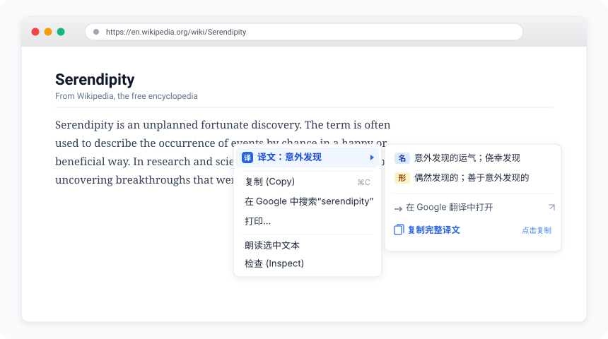
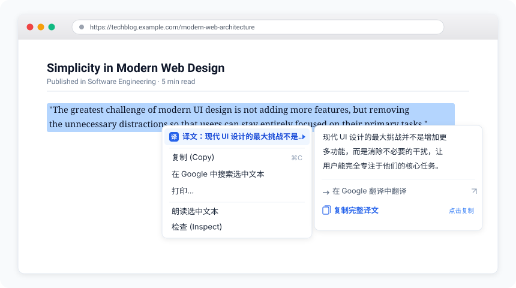
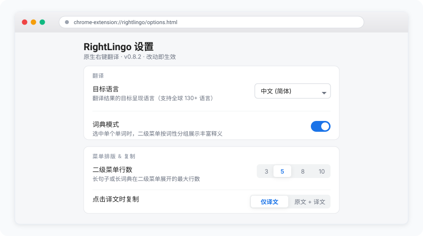

<div align="center"><a name="readme-top"></a>


<h1>RightLingo</h1>

Chrome 原生右键菜单翻译插件 · 选中文本，右键直达译文与词典

[](https://github.com/hexwarrior6/rightlingo)
[](LICENSE)
[](manifest.json)
[](manifest.json)
[](background.js)
[](languages.js)

[English](README.md) · 简体中文

</div>

---

## 🌟 项目简介

**RightLingo** 是一款专注于沉浸式体验的 Chrome 原生右键菜单翻译插件。

市面上常见的划词翻译插件通常会在网页上弹出浮动小图标、悬浮气泡或遮挡内容的翻译弹窗，不仅经常破坏页面排版，还打断阅读心流。**RightLingo 采用完全不同的思路**：

* ⚡ **右键直显，零弹窗打扰**：完全依附于浏览器原生右键菜单，不在网页 DOM 中插入任何浮动 UI，零页面污染。
* ⏱️ **预热加载，毫秒级直出**：在用户选中文字的瞬间即可在后台预请求翻译，当你轻点右键时，主译文已在菜单第一项等候。
* 📖 **智能词典模式**：选中单个单词自动触发词典，在二级菜单中按词性分组展示丰富释义。
* 📋 **点按即复制**：点击菜单中任意译文项即可直接将结果复制到系统剪贴板。

---

## 📸 效果演示与截图

### 1. 智能词典模式
> 选中单词时，二级菜单自动按词性（名、动、形、副等）结构化展示多种释义。

<p align="center">
  
</p>

### 2. 长句优雅排版
> 选中长句或段落时，一级菜单生成精炼摘要，二级菜单按系统菜单宽度优美分行折叠，并支持一键跳转 Google 翻译网页版阅读全文。

<p align="center">
  
</p>

### 3. 清爽现代的设置页
> 纯净的卡片式配置面板，改动通过 `chrome.storage.sync` 账号漫游且即时生效，无需手动刷新网页。

<p align="center">
  
</p>

---

## 🚀 核心功能

* **⚡ 原生集成，零打扰**  
  无浮动气泡、无遮挡弹窗，仅在用户主动触发右键时展示，保持阅读视野干净纯粹。
* **⚡ 毫秒响应，无感等待**  
  监听选区变化即时预热翻译，右键瞬间译文已呈现于菜单首行。
* **📖 智能词典与词性分组**  
  查词时自动按语法词性（名词、动词、形容词等）归类展示多种释义，告别单一呆板翻译。
* **📄 长文本防截断排版**  
  严格控制行宽（约 52 字符），避免 macOS/Windows 菜单把长词从中间抠掉省略号；支持词边界截断，防止单词被腰斩翻译出错。
* **📋 一键写入系统剪贴板**  
  点击任意译文项即可复制。支持配置「仅复制译文」或「原文 + 译文」两行拼接，极度适合背单词与日常摘录笔记。
* **🌍 全球 130+ 语言支持**  
  接入 Google 翻译公开引擎，支持源语言自动检测、原生语言名称（Endonym）显示及简繁互转。
* **🔒 极度纯净，隐私安全**  
  采用标准 Manifest V3 架构，无任何埋点统计、无第三方数据中转服务器、无广告，选中文本仅直接请求翻译接口。

---

## ⚙️ 快速上手

### 从 Chrome 网上应用店安装
> *Chrome Web Store 正在审核准备中，敬请期待。*

### 开发者模式手动加载

1. 克隆或下载本项目至本地：
   ```bash
   git clone https://github.com/hexwarrior6/rightlingo.git
   ```
2. 打开 Google Chrome 浏览器，在地址栏输入：
   ```text
   chrome://extensions
   ```
3. 在页面右上角开启 **「开发者模式」**。
4. 点击左上角的 **「加载已解压的扩展程序」**，选择项目的根目录（`rightlingo/`）。
5. *(推荐)* 在浏览器右上角拼图图标中将 RightLingo 图标固定，方便随时右键打开选项配置。

---

## 🛠️ 个性化设置

右键点击工具栏上的 RightLingo 图标并选择 **「选项」** 即可打开配置页：

| 设置项 | 默认值 | 功能说明 |
| :--- | :--- | :--- |
| **目标语言** | 中文 (简体) | 支持全球 130+ 种语言任意切换。 |
| **词典模式** | 开启 | 选中单词时在二级菜单按词性分组展示详细释义。 |
| **二级菜单行数** | 5 行 (可选 1–10) | 控制长句子或长词典在二级菜单展开的最大行数。 |
| **一级摘要长度** | 中 (短 / 中 / 长) | 调节一级菜单触发“摘要 + 二级菜单”的分界阈值。 |
| **“在 Google 翻译中翻译”项** | 显示 | 控制是否在二级菜单底部显示网页版快捷入口。 |
| **点击译文时复制** | 仅译文 | 可选「仅译文」或「原文 + 译文」（方便记单词与双语笔记）。 |

---

## 📦 项目目录结构

```text
rightlingo/
├── manifest.json       # Chrome 扩展配置清单 (Manifest V3)
├── background.js       # Service Worker：菜单管理与翻译调度中心
├── content.js          # Content Script：轻量选区监听与预热信号
├── translate.js        # 独立翻译引擎模块（解耦设计，方便后续扩充模型）
├── display.js          # 纯函数排版模块：菜单宽度计算与折行分词
├── settings.js         # 设置默认值与 chrome.storage.sync 存取逻辑
├── languages.js        # 130+ 种语言列表与原生名称 (Endonym) 映射
├── options.html / js   # 选项设置页
├── offscreen.html / js # MV3 官方离线剪贴板执行环境
├── _locales/           # 原生国际化多语言资源包 (en, zh_CN, zh_TW)
├── icons/              # 扩展图标（SVG 原稿与 16/32/48/128px PNG）
└── docs/               # 截图素材、PRD 文档与内部开发技术说明
```

---

## 📄 开源许可

本项目基于 [MIT License](LICENSE) 协议开源。
